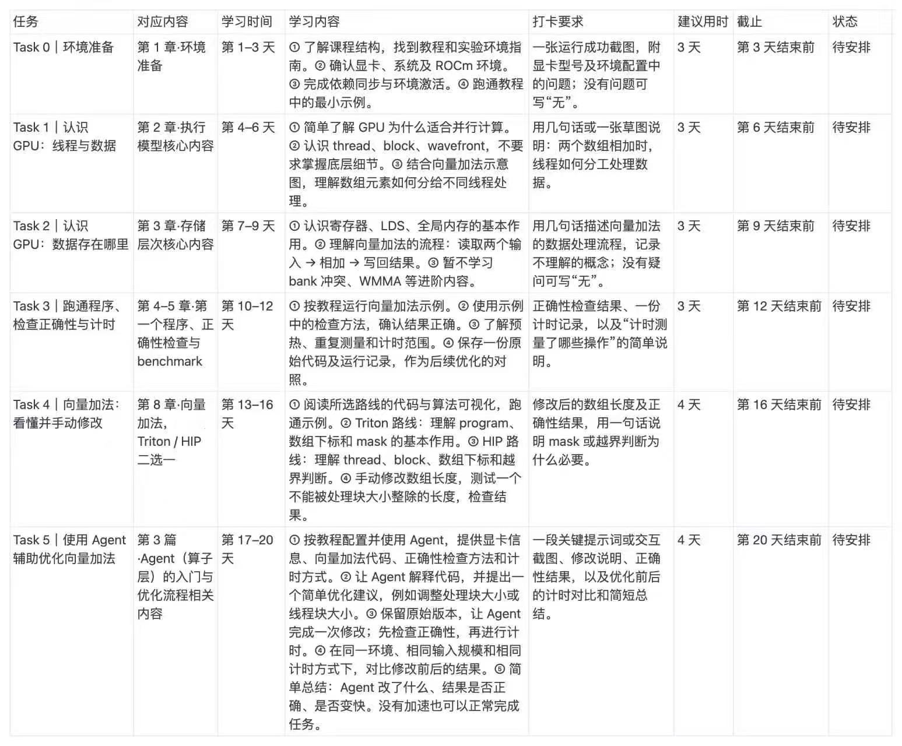

# Hello GPU 学习笔记

[English](README.md) | 简体中文

Hello GPU 个人学习笔记，提供英文和中文版本。

## 学习任务

| 目录 | 内容 |
|---|---|
| [Task 0](notes/task-0-environment/note.zh.md) | 环境准备 |
| [Task 1](notes/task-1-execution/note.zh.md) | 线程与数据分工 |
| [Task 2](notes/task-2-memory/) | GPU 存储与数据流 |
| [Task 3](notes/task-3-validation-timing/) | 正确性与计时 |
| [Task 4](notes/task-4-vector-add/) | 手动修改向量加法 |
| [Task 5](notes/task-5-agent/) | Agent 辅助优化 |

## 课程

- [Hello GPU](https://github.com/datawhalechina/hello-gpu)
