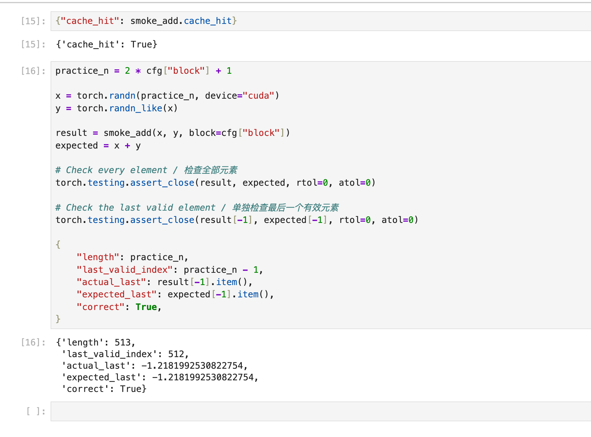

# Task 0: Environment Preparation

English | [简体中文](note.zh.md)

## PyTorch and HIP

PyTorch provides implementations of operations such as addition. HIP lets me write the GPU kernel myself. A kernel is a function executed by GPU threads.

In this experiment, PyTorch manages the tensors, while my HIP kernel defines how the GPU calculates each output element.

## Compilation cache

The Notebook helper caches the compiled kernel so it can be reused in later calls when the source and build configuration match. Input and output tensors are separate from the compilation cache.

## Thread blocks

A thread block is a group of GPU threads. In this addition kernel, each thread computes one output element. In other kernels, a thread can process multiple elements or perform multiple computation steps.

## Experiment result

HIP compilation cache was reused. The 513-element addition passed both the full-array check and the last-element check (index 512).

