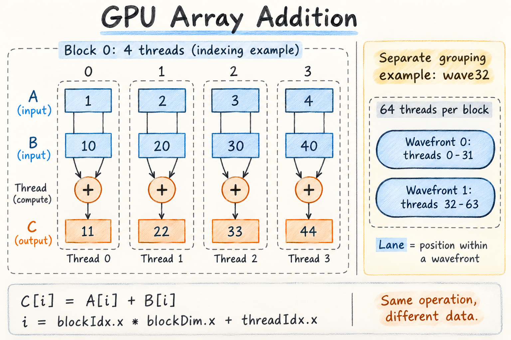

# Task 1：GPU 线程与数据分工

[English](note.en.md) | 简体中文

使用 GPU 进行两个数组相加时，我们指定线程块的数量，以及每个线程块中的线程数量。一次核函数启动中的所有线程块组成一个 Grid。每个线程块内部的线程，根据核函数采用的 wave 大小组织成 Wavefront。Lane 表示线程在 Wavefront 内的位置。

每个线程执行相同的核函数，但处理分配给自己的数据。在这个例子中，每个线程通过下面的公式计算自己负责的数组下标：

```cpp
int i = blockIdx.x * blockDim.x + threadIdx.x;
```

其中，`blockIdx.x` 是块号，`blockDim.x` 是每块的线程数量，`threadIdx.x` 是线程在块内的编号。

如果 `i` 在数组的有效范围内，线程就读取 `A[i]` 和 `B[i]`，将它们相加，再把结果写入 `C[i]`。多余的线程跳过数组访问：

```cpp
if (i < n) {
    C[i] = A[i] + B[i];
}
```

由于各个位置的加法互不依赖，不同线程可以并行处理。



主图中，一个块内的四个线程计算 `[1, 2, 3, 4] + [10, 20, 30, 40] = [11, 22, 33, 44]`。每个线程都读取自己负责的一对元素、相加并写回结果。右侧是另一个独立示例：一个采用 wave32 的 64 线程块包含两个 Wavefront。主图中每块四个线程的编号示例，并不代表 wave 大小是四。

**对最初理解的修正：** 我们既指定块数，也指定每块的线程数。Wavefront 数量由块内线程数量和核函数采用的 wave 大小决定。Lane 表示线程在 Wavefront 内的位置；线程实际访问哪个数组元素，由核函数中的索引公式决定。

来源：[Hello GPU 第 2 章：编程模型与 wavefront 执行](https://datawhalechina.github.io/hello-gpu/part0-intro/chapter2/)。
